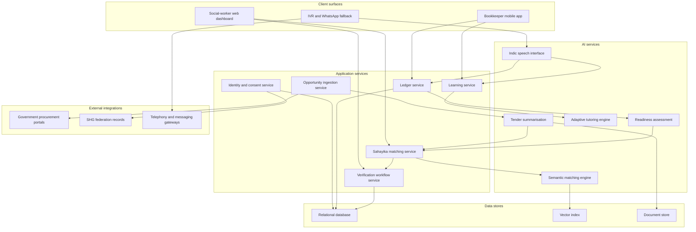

# FinAura

FinAura is a platform design for connecting rural Indian women in Self-Help Groups (SHGs) to economic opportunity — government procurement, institutional buyers, training, and capital — through AI-assisted matching that is always verified by a professional social worker and always decided on by the group itself.

The SHG movement, exemplified by Kudumbashree in Kerala and the national SHG-Bank Linkage Programme, reliably builds savings discipline, group creditworthiness, and vocational skill. What it does not reliably build is connection: the link between a woman's new capability and a buyer, tender, or training programme outside her village's social reach. FinAura specifies the software, the AI components, and the human decision points needed to close that specific gap, without claiming to solve the structural barriers beneath it. The opportunity-matching module at the platform's centre is named Sahayika, the name under which the matching concept was developed in the originating coursework.

## Project status

This repository is at the design-specification stage. It contains two files: this README and a GPL-3.0 license. There is no application code, no schema, no infrastructure configuration, and nothing runnable.

Accordingly, this document is a specification, not documentation of working software. Every component described below — every service, data store, AI model, and integration — carries the status marker `Proposed`; nothing is `Implemented` or `In progress`. The architecture, data model, and pipeline sections describe intended design, and the Repository structure section describes an intended layout, not the current one.

The project originates from a Human and Social Values course project on social work as a pathway to sustainable development. The conceptual argument — the analysis of the SHG pathway and the gap FinAura targets — is the completed work; the platform is its proposed technical continuation.

## Problem

Rural women in India face four structural barriers that compound one another. Assets: land, housing, and productive equipment are rarely titled in a woman's name, removing the standard basis for collateral. Credit: women receive credit equivalent to 27 percent of the deposits they contribute, against 52 percent for men (World Bank, "Improving women's access to credit in India," citing a 2020 study). Mobility: approximately one in four married rural women is not involved in decisions about her own healthcare, major household purchases, or visits to family (National Family Health Survey, NFHS-5, 2019-21) — and a woman who cannot decide whether to visit her relatives cannot freely travel to a district market or a bank branch. Unpaid domestic labour: hours of work that never enter the formal economy and never appear in any ledger.

The context is changing quickly, which raises the stakes. Rural female labour force participation rose from 24.6 percent in 2017-18 to 47.6 percent in 2023-24 (Periodic Labour Force Survey / Economic Survey 2023-24, Ministry of Statistics and Programme Implementation). But 76.9 percent of rural working women are employed in agriculture, work that is largely informal and seasonal (PLFS 2023-24 analysis, MoSPI), and 19.28 percent of India's rural population is multidimensionally poor, against 5.27 percent urban (NITI Aayog, National Multidimensional Poverty Index, 2023). More women are working; most are working informally, seasonally, and poor.

Self-Help Groups, organised and accompanied by professional social workers, address a substantial part of this: a group of ten to twenty women saves together, lends internally, and becomes creditworthy as a collective without any member holding collateral. The model is proven at national scale. As at 31 March 2024, 77 lakh SHGs were credit-linked to banks, 84 percent of them exclusively women's groups, with 2,59,663.72 crore rupees in bank loans outstanding, averaging 3.35 lakh rupees per group (NABARD, "Status of Microfinance in India 2023-24"). Kudumbashree, launched in 1998 by the Government of Kerala with NABARD, has roughly 46 lakh women members and covers more than half of Kerala's households, with cumulative thrift savings of 8,770 crore rupees and internal loans of 27,506 crore rupees; women hold 54 percent of Kerala's 21,900 local body seats, and about 70 percent of those women come from Kudumbashree.

The gap is that this pathway produces capability without necessarily producing connection. A woman completes tailoring training through her SHG and can produce school uniforms to specification, but the demand for uniforms — government procurement, institutional kitchens and hostels, private supply chains — is dispersed across systems her group's local network does not reach. Tenders are published in English on portals nobody in the village browses; a buyer two districts away cannot discover that a federation within delivery distance can meet its order. The SHG's network is dense but local; the opportunity landscape is thin but wide, and no amount of local organising closes a gap whose other side is a website in another language, in another district, on a deadline.

FinAura addresses the information, geographic, and market-access dimensions of that gap — and only those. It does not undo the four structural barriers: a woman matched to a tender still has no land in her name, and her group's bank loan still depends on the linkage programme, not the platform. Stating this plainly defines what the platform is: a connection layer on top of a proven capability-building pathway, not a substitute for any part of it.

## Approach

FinAura is organised as five layers, and the order is a dependency chain, not a feature list. Each layer produces the data or the confidence that the next layer consumes; skipping a layer breaks the one above it.

1. **Capability profile.** Before anything can be matched, the system must know in structured form what a group can actually do: skills, certificates, production capacity, equipment, delivery history. Captured with the social worker during routine meetings.
2. **Financial literacy.** A match is only useful to someone who can evaluate it. Voice-first lessons on pricing, costing, banking, and contracts let the group interrogate an opportunity's numbers rather than defer to whoever presents it.
3. **Budgeting and group bookkeeping.** The group's ledger — thrift, internal loans, repayments — becomes digital. Beyond its own value, it produces the platform's most honest signal: the group's real financial discipline, which the readiness layer later reads.
4. **Opportunity matching (Sahayika).** Only with a profile to match from, literacy to evaluate with, and a ledger to demonstrate discipline does matching become responsible rather than reckless. Sahayika ingests opportunities, matches them semantically against group capabilities, and routes every candidate to a social worker before any group sees it.
5. **Community, mentorship, and capital access.** Mentorship between groups, inter-group lending within existing federation structures, and a gateway to grants and impact capital. It sits last because it depends on everything below: a mentor match needs profiles, a lending decision needs ledgers, a grant application needs the delivery history matching created.

Read bottom-up, the chain is: know what the group can do; make sure the group can judge; record how the group behaves; connect the group to demand; then, and only then, connect the group to capital and peers.

## Division of roles

The platform never replaces the social worker. Technology discovers and proposes; the social worker verifies, facilitates, and accompanies; the SHG decides whether to participate and on what terms. This is a design invariant enforced in the architecture: no match reaches a group without a verification record, no acceptance without a group decision.

| Platform | Social worker | Self-Help Group |
|---|---|---|
| Ingests and summarises opportunities from portals and partners | Verifies that an opportunity is genuine and the counterparty real | Decides whether to pursue a verified opportunity |
| Proposes matches between opportunities and group capabilities | Assesses whether the match is realistic for this group now | Decides on what terms to participate, by its own rules |
| Maintains capability profiles and the group ledger | Facilitates profile capture and audits ledger entries | Owns its data; grants and revokes consent collectively |
| Delivers literacy content and tracks progress | Accompanies groups through contracts and disputes | Elects the bookkeeper who operates the app on its behalf |
| Surfaces readiness signals and match explanations | Overrides, delays, or rejects any automated proposal | Provides the ground truth the system learns from |

The human verification step is non-negotiable for three reasons. Fraud: ingestion pulls from open portals and submissions, and a fabricated tender reaching a group directly could extract advance payments or identity documents from the population least equipped to absorb the loss. Contractual exposure: accepting an order creates enforceable obligations — delivery dates, quality specifications, penalties — and a group must enter those with a professional who has read the contract, not a summary alone. Informed consent: consent extracted through an interface a member cannot fully read is not informed; the social worker explains, in the member's language and context, what participation actually commits her to.

## System architecture

The following describes the intended architecture. Every component is `Proposed`; none exists in this repository.



**Client surfaces.** The social-worker web dashboard (`Proposed`) is the verification and case-management surface: pending matches, group portfolios, consent administration. The bookkeeper mobile app (`Proposed`) is an offline-first Android application operated by each group's elected bookkeeper for ledger entry, profile updates, and lesson playback on a shared device. The IVR and WhatsApp fallback (`Proposed`) serves members without smartphones: an ordinary voice call reaches the speech interface, and WhatsApp carries notifications where available.

**Application services.** The identity and consent service (`Proposed`) manages members, groups, roles, and the consent registry, including revocation. The ledger service (`Proposed`) records thrift, loans, and repayments, append-only, with social-worker audit. The opportunity ingestion service (`Proposed`) pulls from procurement portals and accepts partner submissions. The Sahayika matching service (`Proposed`) orchestrates the pipeline described below. The learning service (`Proposed`) sequences literacy content and tracks progress. The verification workflow service (`Proposed`) holds every candidate match in a queue only a social worker can release.

**AI services, data stores, external integrations.** The five AI services (all `Proposed`) are specified in the next section. The relational database (`Proposed`) holds entities of record; the vector index (`Proposed`) holds capability and opportunity embeddings; the document store (`Proposed`) holds original tender documents and certificates. External integrations (all `Proposed`) are read-side connections to procurement portals, reconciliation against SHG federation records, and commercial telephony and messaging gateways.

## AI components

Each component below is `Proposed`. Model classes are described without naming commercial vendors; any model meeting the described capability can fill the slot.

### Speech interface for Indic languages

Converts member speech in Indian languages to text and system responses back to speech, so the IVR surface and shared-device app work for members who do not read fluently. Menu-driven DTMF IVR is insufficient because the interactions that matter — asking why a repayment amount changed, answering a comprehension question — are open-ended, and keypad menus collapse them into paths the member did not choose. The approach is a multilingual automatic speech recognition model fine-tuned on Indic languages, paired with matching text-to-speech. Inputs: audio from telephony or the app microphone, plus a language hint from the member profile. Outputs: transcripts with confidence scores, and synthesised audio. Failure mode: accuracy degrades sharply on dialectal speech and code-switching, so a member's "EMI" or "tender" embedded in Malayalam speech may be mistranscribed on exactly the words that matter most; low-confidence transcripts must route to a human callback rather than a guessed answer.

### Semantic capability-to-opportunity matching

Finds opportunities a group could plausibly fulfil even when the two vocabularies do not overlap. Keyword matching is insufficient: a tender says "supply of stitched garments conforming to IS specifications," a profile says "tailoring, school uniforms, 200 pieces per month" — zero token overlap, near-perfect real match. The approach is embedding-based retrieval: a multilingual text-embedding model places capability profiles and opportunity summaries in a shared vector space, with re-ranking over structured constraints afterward. Inputs: the capability profile and the summarised opportunity record. Outputs: a ranked candidate list with similarity scores and the profile fields that drove each score. Failure mode: semantic similarity without feasibility — the model will happily match a two-loom weaving group to a tender for ten thousand metres of fabric because the descriptions are close, which is why capacity and logistics constraints are enforced as hard filters after retrieval, not left to the embedding.

### Procurement and tender document summarisation

Reduces a multi-page tender PDF — formal English, legal boilerplate — to a structured summary: what is being bought, quantity, quality standards, deadline, eligibility, payment terms, penalties. Template or regular-expression extraction is insufficient because tender formats vary by issuing body and change without notice. The approach is a large language model performing structured extraction into a fixed schema, constrained to quote the source document for every field. Inputs: the original document from the document store. Outputs: a schema-conformant summary with page-level citations, in English and the group's language. Failure mode: hallucinated or silently omitted terms — a summariser that misses a penalty clause or invents a lenient deadline creates real contractual exposure, which is why every field carries its citation and the social worker verifies the summary against the cited pages before any group sees it.

### Adaptive financial tutoring with retrieval grounding

Delivers financial literacy as a dialogue: the tutor asks, listens, and adjusts to what the member already understands. Static recorded lessons are insufficient because members arrive with widely different starting points, and a fixed sequence bores some while losing others; the drop-off is the failure. The approach is a large language model in a tutoring loop, retrieval-grounded against a curated corpus of vetted financial content (RBI customer-education material, NABARD and Kudumbashree curricula) so that every substantive claim is drawn from the corpus, not open-ended generation. Inputs: transcribed member speech, the learning-progress record, retrieved corpus passages. Outputs: the next tutoring utterance and an updated progress assessment. Failure mode: confident financial misinformation when retrieval returns nothing relevant and the model answers anyway; the mitigation is a hard rule that out-of-corpus questions produce "ask your social worker at the next meeting" rather than an improvised answer.

### Group readiness assessment

Estimates whether a group is operationally ready for a given opportunity size, from its ledger history: regularity of meetings and thrift, internal repayment behaviour, past delivery outcomes. A single threshold rule ("six months of regular savings") is insufficient because readiness is multivariate — a group with irregular thrift but two completed deliveries is more ready than one with perfect savings and no production history. The approach is a deliberately interpretable model class — gradient-boosted trees or a scored rule ensemble over engineered ledger features — chosen over deep models because every score must be explainable to the social worker and the group in plain language. Inputs: ledger aggregates, meeting attendance, delivery history, group tenure. Outputs: a readiness band (not a precise score) per opportunity size class, with the top contributing factors stated. Failure mode: encoding disadvantage as unreadiness — a group that is poor because its district is poor has thinner ledgers, and a naive model converts that poverty into permanent exclusion; the mitigations are banding rather than ranking, per-federation calibration, and the social worker's authority to override the band with a recorded reason.

## Data model

Intended core entities. Types are indicative. In the Notes column, `PII` marks personally identifiable fields and `group` marks fields that are group-level, held about the collective rather than any individual.

**SelfHelpGroup**

| Field | Type | Description | Notes |
|---|---|---|---|
| group_id | UUID | Primary identifier | group |
| name | text | Group's registered name | group |
| federation_id | UUID | Parent federation or CDS | group |
| village, district, state | text | Location at village granularity only | group |
| formed_on | date | Formation date | group |
| bookkeeper_member_id | UUID | Currently elected bookkeeper | references PII |
| consent_status | enum | Group-level platform consent: active, suspended, revoked | group |

**Member**

| Field | Type | Description | Notes |
|---|---|---|---|
| member_id | UUID | Primary identifier | PII |
| group_id | UUID | Owning group | group |
| name | text | Member's name | PII |
| phone | text | Contact number, may be a shared household phone | PII |
| preferred_language | text | Language for speech and content | PII |
| joined_on | date | Date of joining the group | PII |

**CapabilityProfile**

| Field | Type | Description | Notes |
|---|---|---|---|
| profile_id | UUID | Primary identifier | group |
| group_id | UUID | Profiled group; profiles are group-level by design | group |
| skills | text[] | Verified skills of the membership | group |
| certifications | jsonb | Training certificates with issuer and date | references PII |
| capacity | jsonb | Output per period, by product | group |
| equipment | text[] | Productive assets available to the group | group |
| embedding_ref | text | Pointer into the vector index | group |

**Opportunity**

| Field | Type | Description | Notes |
|---|---|---|---|
| opportunity_id | UUID | Primary identifier | — |
| source | enum | Portal, partner submission, or manual entry | — |
| summary | jsonb | Structured extraction with citations | — |
| document_ref | text | Original document in the document store | — |
| deadline | date | Submission or delivery deadline | — |
| size_class | enum | Order size band used by readiness assessment | — |

**Match**

| Field | Type | Description | Notes |
|---|---|---|---|
| match_id | UUID | Primary identifier | group |
| group_id, opportunity_id | UUID | The matched pair | group |
| score | numeric | Retrieval and re-ranking score | group |
| reasons | jsonb | Human-readable ranking signals; required, never null | group |
| status | enum | proposed, verified, presented, accepted, declined, completed | group |

**VerificationRecord**

| Field | Type | Description | Notes |
|---|---|---|---|
| verification_id | UUID | Primary identifier | — |
| match_id | UUID | Match under verification | group |
| social_worker_id | UUID | Verifying professional | PII |
| decision | enum | approved, rejected, needs-information | — |
| rationale | text | Required free-text reason | — |
| decided_at | timestamp | Decision time | — |

**LedgerEntry**

| Field | Type | Description | Notes |
|---|---|---|---|
| entry_id | UUID | Primary identifier; entries are append-only | group |
| group_id | UUID | Owning group | group |
| member_id | UUID | Contributing or borrowing member, if applicable | PII |
| kind | enum | thrift, internal-loan, repayment, expense, income | — |
| amount | numeric | Amount in rupees | PII when member-linked |
| recorded_by | UUID | Bookkeeper or social worker who entered it | PII |

**LearningProgress**

| Field | Type | Description | Notes |
|---|---|---|---|
| progress_id | UUID | Primary identifier | PII |
| member_id | UUID | Learner | PII |
| module | text | Curriculum module identifier | — |
| mastery | enum | Banded assessment from the tutoring engine | PII |
| updated_at | timestamp | Last interaction | — |

Two deliberate choices: profiles and matches are group-level, because opportunity and credit in the SHG model attach to the collective; and ledger rows become personally identifiable the moment a member_id is attached, so member-linked ledger data is treated with the same sensitivity as identity data.

## Matching pipeline

The six steps from capability registration to group decision, with the data transformation at each step. The whole pipeline is `Proposed`.

1. **Capability registration.** At a routine meeting, the social worker and bookkeeper record the group's skills, certificates, capacity, and equipment. Transformation: knowledge held in people becomes a structured CapabilityProfile row, and its text rendering becomes an embedding in the vector index.
2. **Opportunity ingestion and summarisation.** The ingestion service pulls new tenders and partner submissions; the summarisation service extracts each into the fixed schema. Transformation: a PDF becomes an Opportunity row with a structured, translated, citable summary — and its own embedding.
3. **Retrieval and constraint filtering.** The semantic engine retrieves candidate groups from the vector index; hard filters remove infeasible candidates — capacity below the order size band, delivery distance beyond a configured radius, deadline inside the group's minimum lead time. Transformation: an opportunity becomes a shortlist of feasible group–opportunity pairs.
4. **Ranking and readiness gating.** Survivors are re-ranked using the signals below, and the readiness assessment assigns each pair a band for the opportunity's size class. Transformation: a shortlist becomes an ordered list of Match rows, each carrying its reasons field.
5. **Social-worker verification.** Every Match enters the verification queue. The social worker checks the opportunity's authenticity, reads the summary against the cited pages, and judges fit for this group now. Transformation: a proposed match becomes a verified match — or a rejected one, with a recorded rationale the ranking can later learn from.
6. **Group presentation and decision.** The social worker presents the verified match at a group meeting, in the group's language, with the reasons and the obligations. The group decides by its own rules. Transformation: a verified match becomes accepted or declined, and an acceptance eventually becomes delivery history feeding back into the profile and readiness features.

### Ranking signals

Ranking is a weighted combination of: semantic similarity; capacity headroom (how comfortably the order fits, not just whether it fits); delivery distance; deadline slack against demonstrated lead times; readiness band; delivery track record on comparable orders; and a rotation adjustment that reduces the score of groups already holding active matches. Every signal that moves a match is written into its reasons field in plain language, because a ranking that cannot explain itself cannot be verified by a social worker or contested by a group.

### Cold start

At launch there is no delivery history, no readiness calibration, and no evidence that matching works — the classic cold-start problem, which with a vulnerable population cannot be solved by experimenting broadly. The intended answer is a single-federation, single-anchor-buyer launch: one SHG federation whose social workers already know their groups, and one committed institutional buyer with recurring demand (school uniforms, institutional catering, or similar). This bounds the problem on both sides: social workers seed capability profiles from knowledge they already hold, substituting professional judgement for the delivery history the system lacks, and a recurring buyer converts matching from open-ended discovery into a repeated, learnable event, each fulfilment cycle producing real delivery records and ground truth for the ranking weights. Only after demonstrated cycles in this bounded setting does expansion to more federations and buyers become defensible.

## Accessibility and delivery model

The design assumes the member most affected by the platform may never hold it in her hands. Four constraints drive this. Literacy: every lesson, summary, and notification has a voice-first form; text is never the only channel. Language: all member-facing content exists in the member's language, with English confined to the dashboard and source documents. Device access: the design assumes a shared device, not individual smartphone ownership — phones in rural households are frequently owned or controlled by husbands or sons, so requiring a personal smartphone silently excludes the very members targeted, and one bookkeeper's device per group is a defensible floor. Connectivity: the bookkeeper app is offline-first, syncing when a connection appears; the IVR path needs only an ordinary phone call.

These constraints resolve into an assisted-access pattern: the elected bookkeeper operates the app on the group's behalf during meetings — entering the ledger, playing lessons aloud, showing match explanations — and the social worker operates the dashboard on the federation's behalf, while members without any device reach the system by voice call. Assisted access is not a compromise on the way to individual accounts; it mirrors how SHGs already work, where the bookkeeper keeps the register and the group acts collectively, and it keeps the technology inside the group's existing accountability structure.

## Regulatory and ethical considerations

**Capital access framing.** The capital layer is deliberately framed as two things and not a third. It supports inter-group lending within existing SHG federation structures — federations already intermediate funds between member groups under established norms — and it acts as a gateway to grants and impact capital, where the platform surfaces eligible groups and the transaction happens through the funder's own process. It is not a peer-to-peer investment marketplace, and this is a legal boundary, not a stylistic one: pooling public investment and operating peer-to-peer lending platforms in India are regulated activities requiring authorisation. An earlier framing of this project described members investing in each other's ideas through the platform; that framing is retired here precisely because it would walk into regulated territory without authorisation.

**Data protection and consent.** The platform holds financial and identity data belonging to a vulnerable population, and consent is designed to match how that population actually decides. Consent is group-level first: a group joins by collective resolution, explained by the social worker in the group's language, and can revoke — at which point matching stops, profiles are withdrawn from the index, and member data is deleted subject only to legally required financial records. Individual members can decline data collection beyond the group ledger without leaving their group. No member data reaches a buyer, funder, or other external party except the minimum required for a match the group has already accepted. Location is stored at village granularity, and the platform holds no biometric or government-ID numbers unless a specific integration demands it — in which case that integration is the thing to question.

**Elite capture.** Left alone, matching concentrates: the best-connected, best-documented groups win the first matches, accumulate delivery history, rank higher, and win everything thereafter — reproducing inside the platform the inequality it exists to reduce. Two mitigations are built into the ranking. Rotation: a group holding active matches has subsequent scores reduced until delivery completes. Capacity caps: no group may hold matched commitments beyond its profiled capacity, protecting buyers from non-delivery and preventing dominant groups from warehousing opportunities. Federation-level reporting shows social workers the distribution of matches across groups, so concentration is visible early.

**Algorithmic accountability.** Every match surfaces its reasons in language a social worker can verify and a group can contest, and no automated decision is final anywhere in the system. Matching proposes; verification disposes. A readiness band can be overridden with a recorded reason; a summary is checked against its cited pages before presentation. The system's outputs are, structurally, recommendations to professionals and collectives who retain the authority to refuse them.

## Alignment with Sustainable Development Goals

The platform strengthens an existing pathway; it does not achieve these goals on its own, and every claim below is conditional on the SHG ecosystem, social workers, and buyers it depends on.

| SDG | Platform mechanism |
|---|---|
| SDG 1: No poverty | Can raise group income by connecting existing productive capability to demand the local network does not reach; it does not create capability or income by itself. |
| SDG 5: Gender equality | Can reinforce women's collective economic agency by routing opportunity and capital through women-governed groups; it does not change household norms or asset ownership. |
| SDG 8: Decent work and economic growth | Can shift some work from informal, seasonal arrangements toward contracted institutional orders with recorded terms; it cannot formalise work for which no buyer exists. |
| SDG 10: Reduced inequalities | Can direct institutional demand toward rural collectives ordinarily excluded from it, provided the rotation and capacity-cap mechanisms hold; without them it could widen gaps between groups. |

## Technology stack

Every choice below is `Proposed`; none is installed in this repository. Items not yet chosen are marked undecided.

- **Client:** Web dashboard — undecided between mainstream reactive frameworks, since dashboard needs are conventional. Bookkeeper app — an offline-first Android application, because shared Android devices are the realistic floor; framework undecided.
- **Voice and messaging:** Commercial telephony and WhatsApp Business gateways, because building telephony infrastructure is not this project's problem; specific providers undecided.
- **Application services:** A single modular backend (Python) rather than microservices, because the team is two students and operational simplicity dominates; web framework undecided.
- **AI:** Model classes as specified in AI components; whether each slot is filled by a hosted API or a self-hosted open-weight model is undecided and will be settled per component on cost, latency, and data-residency grounds.
- **Data:** PostgreSQL for entities of record, because relational integrity and audit trails are the core requirement; vector index undecided between a PostgreSQL extension and a dedicated store, with the extension preferred until scale forces otherwise; object storage for documents, provider undecided.
- **Infrastructure:** Undecided, with a stated requirement that data reside in India.

## Repository structure

Current actual structure:

```
FinAura/
├── LICENSE     GPL-3.0 license text
└── README.md   This document
```

Intended structure, once implementation begins (this layout is a plan, not a description of existing directories):

```
FinAura/
├── backend/          Application services: consent, ledger, ingestion, matching, learning, verification
├── ai/               AI service adapters: speech, embedding, summarisation, tutoring, readiness
├── dashboard/        Social-worker web dashboard
├── bookkeeper-app/   Offline-first Android app for group bookkeepers
├── ivr/              IVR call-flow definitions and gateway integration
├── docs/             Design documents, including the originating coursework analysis
├── LICENSE
└── README.md
```

## Getting started

There is nothing to run yet. The repository contains no code, so there are no prerequisites to install, no environment variables to configure, and no test suite to execute; any command listed here would fail. This section will be rewritten with concrete, tested instructions when the first runnable component lands in Phase 1 of the roadmap.

## Roadmap

Phases are defined by the capability delivered, not by dates.

1. **Ledger and profiles.** Digital group bookkeeping and capability-profile capture for one partner federation, with the dashboard for audit and consent administration. Delivered when the federation's groups run their ledgers on the platform through a full savings-and-lending cycle.
2. **Learning by voice.** The Indic speech interface and retrieval-grounded tutor deliver the literacy curriculum over IVR and the shared device. Delivered when members complete modules by voice alone, with out-of-corpus questions correctly routed to social workers.
3. **Sahayika with one buyer.** The full matching pipeline operates against a single anchor buyer's recurring demand. Delivered when matched orders have completed enough cycles to calibrate readiness bands against real delivery outcomes.
4. **Federation network and capital gateway.** Expansion to additional federations and buyers, inter-group lending within federation structures, and the grant and impact-capital gateway. Delivered when a second federation onboards using the calibrated pipeline and rotation reporting shows distribution rather than concentration.

## Limitations

FinAura does not address land and asset titling; a matched, delivering group still holds no collateral in its members' names. It does not change collateral requirements for formal credit; bank linkage remains governed by the existing programme and the bank's rules. It does not reduce unpaid care work; no matching engine returns hours spent on domestic labour. It does not change the social norms constraining women's mobility; a match a group cannot travel to fulfil is a match the constraint filters must reject — containment of the problem, not a solution to it.

The platform also has hard operational dependencies, without which it is not merely weaker but useless: an existing SHG ecosystem with functioning groups and federations, active social workers with the time and mandate to verify and accompany, and at least one committed institutional buyer whose demand gives the pipeline something real to match against. FinAura is a connection layer. Where there is nothing to connect, it has nothing to offer.

## References

1. Ministry of Statistics and Programme Implementation. Periodic Labour Force Survey, as cited in the Economic Survey 2023-24. 2024.
2. Ministry of Statistics and Programme Implementation. PLFS 2023-24 analysis of rural female employment by sector. 2024.
3. World Bank. "Improving women's access to credit in India," citing a 2020 study. 2020.
4. NITI Aayog. National Multidimensional Poverty Index. 2023.
5. International Institute for Population Sciences and Ministry of Health and Family Welfare. National Family Health Survey (NFHS-5), 2019-21. 2021.
6. NABARD. "Status of Microfinance in India 2023-24." 2024.
7. Kudumbashree Mission, Government of Kerala. Programme statistics on membership, coverage, thrift, internal lending, and local-body representation, as compiled in the originating coursework. Programme launched 1998.

## Authors

Shiva Jyoti (23BDS1015) and Pranay Kumar Karvi (23BDS1137). FinAura originates from their Human and Social Values course project on social work as a pathway to sustainable development, of which this specification is the proposed technical continuation.

## License

This repository is licensed under the GNU General Public License, version 3 (GPL-3.0). See the [LICENSE](LICENSE) file.
